<div align="center">

# Realization

### Stop the process. Replace the model. Resume the meaning.

<p>
  
  
  
  
</p>

**Realization is a research implementation for giving unfinished work a
durable semantic existence: what holds, what remains unresolved, why, and the
exact state from which another reduction may continue.**

`Not<X> -> governed reduction -> Is<X>`

[Get things done](#get-things-done) |
[Resumption](#resumption-the-work-survives-its-machinery) |
[How it works](#how-it-works) |
[Quick start](#quick-start) |
[Architecture](#architecture) |
[Theory](#theory-reading-path)

</div>

---

> [!IMPORTANT]
> **A transcript can preserve what was said. Realization preserves what the
> next reduction is entitled to treat as current.**
>
> The process may stop. Its model session and cache may vanish. A different
> model may later take its place. The work can still resume from an exact,
> persisted account of current state, unresolved obligations, provenance, and
> causal identity rather than from a model's recollection of a conversation.

> [!CAUTION]
> Realization is runnable and extensively tested, but remains pre-alpha
> research software. This is not a claim of AGI, production readiness,
> empirical proof of the theory, or deterministic behavior from external
> models.

## Why It Exists

Generating another answer is comparatively easy. Continuing the *same work*
after its machinery has disappeared is a deeper problem.

A language model can receive yesterday's transcript and produce a plausible
next sentence. But plausibility cannot establish which correction is current,
which candidate was never accepted, which obligation remains open, which
branch is being continued, or whether the new request belongs to that objective
at all. A summary can compress words while silently destroying those
relationships.

Realization treats continuity as a problem of semantic integrity, not
conversational memory. A request begins as a represented remainder:

```text
Not<X> = what remains insufficiently determined, evidenced, governed, or achieved
```

The controller asks whether that remainder should be closed directly, refined
into subordinate remainders, matched to prior artifacts, supported by evidence,
or held because certainty is not yet justified. Progress is not measured by
motion or fluent output. It is measured by increased determination and an
inspectable basis for commitment.

This distinction drives the implementation:

- state survives the process that created it;
- proposals remain separate from admitted facts and actions;
- abilities remain separate from the host operations that realize them;
- model output remains advisory until governed;
- artifacts, receipts, and decisions remain inspectable after the run;
- deterministic operation remains available without an LLM.

## Resumption: The Work Survives Its Machinery

Resumption asks an unusually strict question:

> If the process, model session, cache, and rendered answer all disappear,
> what must remain so that the next reduction continues the same undertaking
> rather than inventing a plausible replacement for it?

The answer is not private reasoning and not a replay of everything ever said.
It is a governed boundary carrying four explicit things:

```text
Resumable State = achieved state
                + non-achievedness
                + supporting provenance
                + exact causal identity
```

The causal identity is the product of `scope x objective x branch x revision`.
That identity turns continuation from a linguistic impression into an
inspectable state transition. A transcript can explain what happened, but it
cannot select the state being continued, recreate supersession, or silently
discharge unresolved work.

This changes the meaning of familiar events:

- A **correction** changes current admitted state without rewriting history.
- An **interruption** stops activity without promoting unfinished work into fact.
- A **restart** or **provider replacement** changes the machinery, not the
  semantic state.
- A **branch** creates another valid future from an exact shared past.
- A **merge** names its parents instead of pretending parallel work was linear.
- A **redirection** forces realignment rather than carrying old assumptions
  forward by accident.
- An **unrelated objective** inherits nothing merely because its words are
  similar.

### Follow Cedar

The story begins with an ordinary request and follows the same undertaking
through changed facts, unfinished thought, vanished machinery, a new model,
changed intent, and parallel futures. Finally, a completely unrelated request
tests the boundary. At a glance, its shape looks like this:

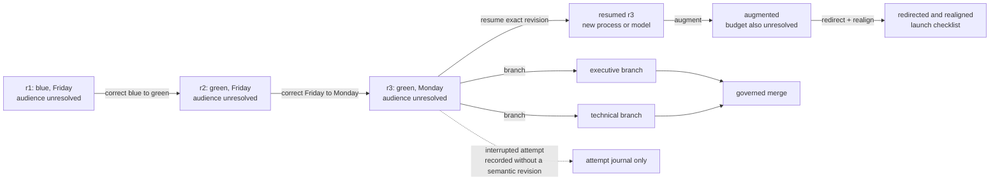

#### It starts with an unfinished brief

The user begins simply: `Create a brief for Cedar, use blue, due Friday.` The
project, color, and deadline can all be admitted. But a useful brief also needs
an audience, and no audience was given. Realization answers the turn without
pretending that the larger undertaking is complete.

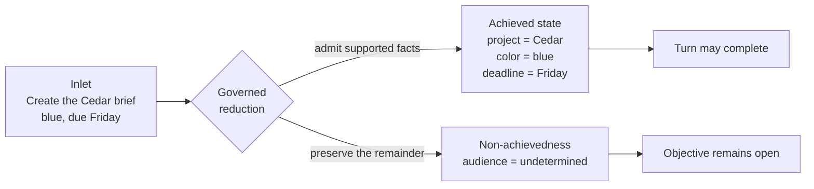

The transcript remembers the sentence. Cedar's governed state remembers
something different: three facts currently hold, and one obligation still
prevents closure. The conversation has moved forward; the work remains
unfinished.

#### The user changes their mind

Then come two ordinary corrections: `Change blue to green`, followed by `Move
the deadline to Monday.` Each one creates a new immutable revision. Blue and
Friday remain part of what happened, but they no longer compete with green and
Monday as current facts. Through both completed turns, the missing audience
quietly remains unresolved.

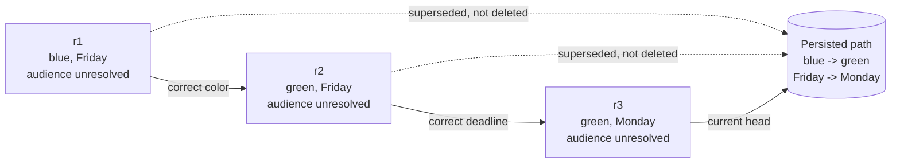

The conversation now contains blue, green, Friday, and Monday. A replay leaves
the next model to infer which pair won. Resuming `r3` does not: green and Monday
are current, the audience is unresolved, and the older values are reachable
through provenance rather than revived as possibilities.

#### Work stops in the middle of a thought

Now reduction turns to the missing audience. `City officials` emerges as a
candidate, but the attempt is interrupted before validation and admission.
Computation stops in the middle of a thought. Cedar's semantic state does not
pretend otherwise.

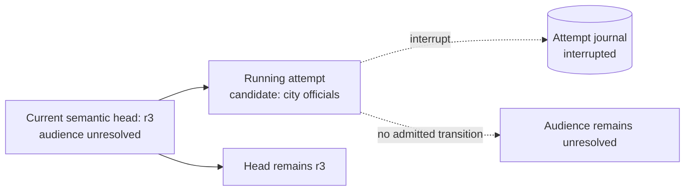

The unfinished candidate need not be forgotten; it can remain in path evidence.
But it is not allowed to become the audience merely because it was the last
thing under consideration. The head remains `r3`, and the audience remains
unresolved.

#### Three words expose the danger of replay

Suppose the user now says: `Change it back.` The phrase is only three words,
yet Cedar has two legitimate predecessors. Does *it* mean green should become
blue, or Monday should become Friday? Recency in the transcript cannot confer
semantic authority on either interpretation.

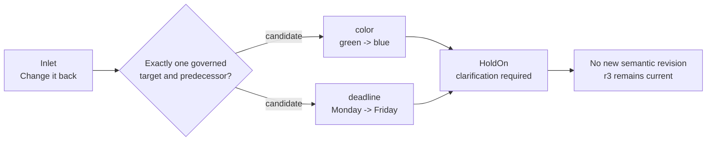

So Realization does not reward a confident guess. The ambiguity becomes
explicit non-achievedness, `r3` remains current, and a later inlet can resolve
the question without first repairing an invented transition.

#### Then the machinery disappears

With `r3` safely admitted, the process terminates. Its cache vanishes. Even the
model provider can be replaced. Later, another host appears with none of that
hidden computational continuity. It does not ask a new model to reconstruct
Cedar from prose; it resumes the exact causal state that survived them both.

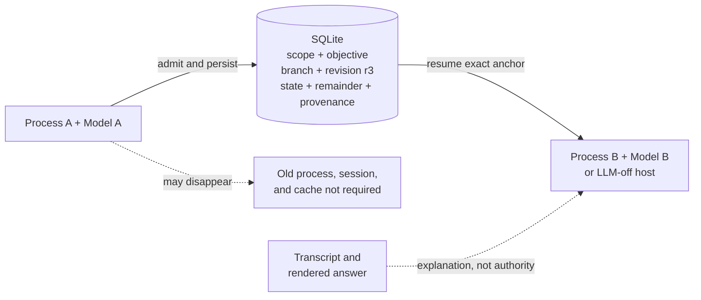

The new machinery may phrase its answer differently. It may use another model,
or no model at all. What it cannot do is silently alter which facts are current,
which obligation remains open, or which revision it continued. The machinery
was replaceable; the meaning of the work was not.

#### The assignment itself changes

After resumption, the user adds: `Also include a budget summary.` Cedar now has
more work, but it is still a brief; nothing was withdrawn. Then the user changes
direction entirely: `Instead, create a launch checklist.` The old undertaking
cannot continue unchanged, yet the new sentence does not say which of Cedar's
existing facts still belong. That is the work of realignment.

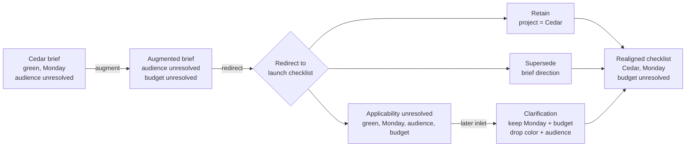

The project remains Cedar and the brief direction is superseded. But green,
Monday, the audience, and the budget do not acquire a new meaning by accident.
Their applicability remains unresolved until the user clarifies: keep Monday
and the budget summary; drop the color and audience requirements. Redirection
changed the destination. Realignment governed what could travel there.

#### The story forks

Resumption need not have only one future. Return to `r3`, before the launch
checklist continuation. One team prepares an executive version of the brief;
another prepares a technical version. Both inherit the same green, Monday, and
unresolved audience. Neither is pretending to be the other.

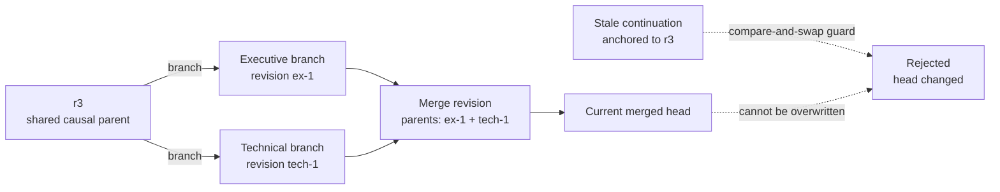

When their work rejoins, the merge names both parents. Meanwhile, an old attempt
still anchored to `r3` tries to write after the head has moved and is rejected.
What would look like neighboring messages in a transcript becomes honest causal
structure: one past, two futures, an explicit reunion, and no last-writer-wins
amnesia.

#### A new journey tests the boundary

Eventually the user says: `Plan my holiday.` The words *plan* and *deadline*
might retrieve Cedar artifacts. A fluent model might even weave them into a
plausible continuation. But the holiday has no Cedar causal identity. It is a
new undertaking, not the next chapter of the brief.

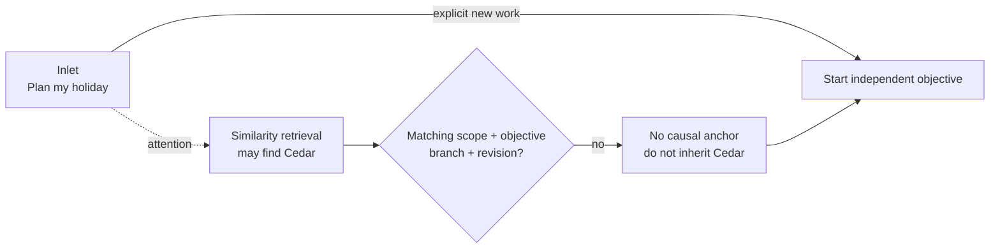

Retrieval may bring Cedar to attention. It cannot make Cedar applicable, and it
cannot manufacture a continuation relationship. The holiday begins without
green, Monday, a budget summary, or a missing audience.

#### Later, someone asks why

Ordinary continuation did not need to carry blue and Friday as live candidates.
But they were never erased. When someone later asks why Monday is current,
requests a reversal, verifies the correction, or rebuilds derived state after
loss, Cedar's persisted path becomes the subject of the next reduction.

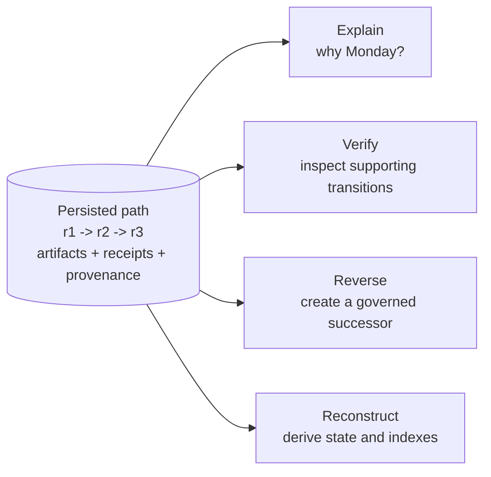

The answer can show that Friday was admitted and Monday superseded it. A
reversal creates another governed successor rather than editing history.
Reconstruction derives state from retained artifacts rather than asking a model
to invent a likely past.

By the end of Cedar's story, the remarkable result is not another generated
sentence. It is that after every correction, interruption, disappearance,
branch, and redirection, the system can still answer:

```text
What is current?
What remains unresolved?
What was superseded?
What was merely proposed?
Which branch and revision are being continued?
What evidence and transition made this state admissible?
```

That is resumption as a governed computational object.

The mechanically decidable contracts run provider-free across the real host,
engine, lifecycle, and SQLite repository. A separate provider-backed Cedar
qualification checks ordinary-language interpretation and rendering. The
project does not claim that a model will interpret every inlet correctly; it
ensures that model judgment cannot silently redefine causal identity,
admission, or the persisted meaning of the work.

## Get Things Done

Choose the smallest surface that matches the work:

| Goal | Start here |
| --- | --- |
| Answer or calculate from deterministic mechanisms, without a model provider | [Run the standalone core](#run-one-local-task) |
| Ground a run in facts supplied by a person or another system | [Add evidence](#add-evidence) |
| Examine or continue a durable run | [Inspect or continue](#inspect-or-continue) |
| Correct, interrupt, resume, branch, merge, or realign governed work | [Use the governed conversation host](#use-the-core-as-a-governed-chat-participant) |
| Learn, export, import, and reuse governed artifacts | [Reuse knowledge and abilities](#reuse-knowledge-and-abilities) |
| Turn source material into a reviewed report | [Workstation and publication](#workstation-and-publication) |
| Embed only the lifecycle engine in another application | [`core_runtime/`](core_runtime/) and [`core_engine/`](core_engine/) |

Start with `--llm off` unless model assistance is necessary. This gives the
clearest view of what Realization itself can determine from rules, supplied
evidence, and admitted artifacts. A run is successful only when its status and
certainty justify closure; the presence of fluent output alone is not success.

## How It Works

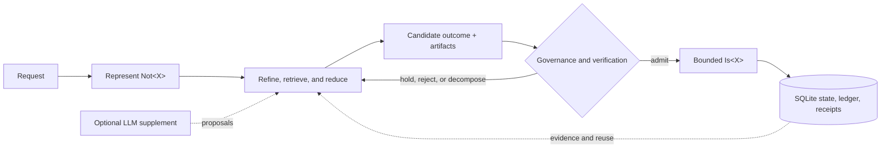

The LLM is not the controller. It may propose a decomposition, interpretation,
or response; it does not silently admit an ability, grant authority, invent a
host implementation, or bypass persisted governance.

### Three bindings, three mechanisms

Ability delivery stays explicit by separating the matches that are often
collapsed in agent systems:

| Binding | Mechanism |
| --- | --- |
| Subject to ability | Explicit scope through linked skill identifiers and subject projection |
| Request to ability | Semantic retrieval and ranking; an LLM may assist interpretation when enabled |
| Ability to host operation | Exact, mechanical binding to a declared executor or broker identity |

A portable ability can be shipped without its host realizer. A host can provide
a realizer without making every ability that references it admitted. Execution
occurs only when declaration, admission, scope, realizer availability, policy,
and invocation authority all agree.

## What Exists Today

| Surface | Current reality |
| --- | --- |
| **Governed core CLI** | Fresh `run`, durable `resume`, read-only `inspect`, and an optional thin `chat` entry host over plain SQLite |
| **Core Python API** | Typed `run`, `resume`, and `inspect` functions behind a narrow package ABI |
| **Reduction loop** | Durable non-achievedness state, bounded steps, evidence, proposals, commitments, artifacts, and ledger entries |
| **Governed resumption** | Exact causal anchors, immutable revisions, interruption, correction, augmentation, redirection and realignment, branching, merge, reversal, reconstruction, and replay |
| **Conversation boundary** | Provider-neutral planning and rendering around mechanical identity, selector resolution, validation, admission, recovery, and receipts |
| **LLM-off mode** | Provider-free execution through deterministic rules, parsers, retrieval, persisted artifacts, and available evidence |
| **Ability system** | Declaration, governance, admission, scope, semantic matching, realizer binding, authority, execution, and receipts in the full workspace |
| **Workstation** | Textual and Flutter clients over shared shell and subject-workflow contracts; visual parity is not claimed |
| **Subject workflow** | Gather, Itemize, Draft, Review, and Publication, with Chat used where conversational shaping is appropriate |
| **Publication** | Governed report planning and reproducible Markdown/Typst-oriented build artifacts |
| **Architecture controls** | A checked boundary manifest, import-graph baseline, qualification manifest, and regression ratchet |
| **Theory corpus** | Explicit theory documents kept distinct from implemented and verified behavior |

### Claim discipline

The project uses these terms narrowly:

| Term | Meaning |
| --- | --- |
| **Implemented** | The behavior exists in source and has a callable path |
| **Deterministically tested** | A provider-free automated gate exercises the behavior |
| **Qualified separately** | The behavior needs credentials, a model provider, browser, desktop service, or platform-specific host |
| **Theory** | A proposed explanatory or governing model; not automatically an implementation claim |

Provider-backed and browser-driven results are never used as substitutes for
deterministic tests. Conversely, provider-free tests do not establish the
quality or repeatability of an external model.

## Quick Start

### Prerequisites

- Python 3.14
- [uv](https://docs.astral.sh/uv/)
- Git

Clone the repository:

```console
git clone https://github.com/Adimpression/realization.git
cd realization
```

### Run one local task

Create a local state directory and run a bounded provider-free request:

```console
mkdir -p state

uv run --frozen --package realized-core realized-core run \
  --prompt "What is 2 + 2?" \
  --sqlite ./state/realization.sqlite3 \
  --state-out ./state/run.json \
  --max-steps 24 \
  --llm off
```

This exact example returns `4` without contacting a model provider. The command
prints a JSON summary, persists reusable artifacts in SQLite, and writes the
durable run state to `state/run.json`.

### Read the outcome

Do not evaluate a run from `final_answer` alone. Check these fields together:

| Field | What it tells you |
| --- | --- |
| `run_outcome` | Whether the bounded run completed, paused, or remained incomplete |
| `root.status` | Whether the root `Not<X>` is closed, paused, or still open |
| `root.certainty` | The certainty attached to the current root state |
| `final_answer` | The current communicative answer, if one was justified |
| `development.artifact_persistence` | Whether reusable artifacts were persisted and where |
| `recent_ledger` | Why the latest transitions, admissions, and commitments occurred |

An incomplete run may still emit a useful candidate answer. That candidate is
not equivalent to a closed, high-certainty result.

### Add evidence

Evidence is explicit input rather than hidden prompt context. Create
`state/evidence.json`:

```json
[
  {
    "target": "root",
    "observation": "The approved budget ceiling is SGD 25,000.",
    "source": "project charter",
    "support_strength": "high",
    "confidence": "high"
  }
]
```

Supply it to a fresh run:

```console
uv run --frozen --package realized-core realized-core run \
  --prompt "What is the approved budget ceiling?" \
  --evidence-file ./state/evidence.json \
  --sqlite ./state/realization.sqlite3 \
  --state-out ./state/budget-run.json \
  --max-steps 24 \
  --llm off
```

Evidence participates in governance; it does not force closure. Realization may
remain incomplete when the supplied observation does not determine the request
strongly enough.

### Inspect or continue

Inspect a saved state without executing another reduction step:

```console
uv run --frozen --package realized-core realized-core inspect \
  --state ./state/run.json
```

Resume from the durable state, optionally adding new evidence. Reuse the same
SQLite store so prior artifacts remain available:

```console
uv run --frozen --package realized-core realized-core resume \
  --state-in ./state/run.json \
  --sqlite ./state/realization.sqlite3 \
  --state-out ./state/resumed.json \
  --llm off
```

Writing resumed state to a new path preserves the prior checkpoint for audit
or comparison.

### Use the core as a governed chat participant

The standalone application also includes a thin terminal conversation host:

```console
uv run --frozen --package realized-core realized-core chat \
  --root ./state/chat \
  --llm off
```

With `--llm off`, or with `--llm auto` when no provider is configured, plain
input creates an independent governed objective. With an available provider,
`auto` and `required` send plain input through the transport-neutral planning
and rendering path; the resulting proposal still crosses the same mechanical
validation and engine boundary. Use
`/use <revision-id>` to select the exact causal revision for related turns.
`/continue <text>` contributes to that objective; when more than one hold is
active, use `/continue <hold-id> -- <text>`. Use
`/follow-up <item-id,...> -- <text>` to derive a new objective from explicitly
selected admitted material. Use `/correct <item-id> -- <replacement>` to
supersede one explicitly identified current item.

The host keeps transcript, exact revision bindings, active user selection, and
SQLite as separate durable domains. It does not use transcript order or a JSON
checkpoint as causal state, and prior chat text is never admitted merely
because it appeared in the conversation.

### Choose an LLM policy

| Mode | Behavior |
| --- | --- |
| `--llm off` | Makes no provider call; closure is limited to deterministic mechanisms and supplied evidence |
| `--llm auto` | Permits configured model assistance while retaining mechanical governance boundaries |
| `--llm required` | Requires the configured model path rather than silently proceeding without it |

Start with `off`. Enable a provider only when the request, data policy, and
qualification context permit sending material outside the local process.
Credential-free templates are provided in
[`local.env.example`](local.env.example) and
[`offline.env.example`](offline.env.example).

List every standalone option directly from the installed command:

```console
uv run --frozen --package realized-core realized-core run --help
```

## The Standalone Core

The distributable core is intentionally split into six cohesive UV projects:

```text
realized-core
    -> realized-core-conversation
        -> realized-core-llm
        -> realized-core-engine
            -> realized-host-interaction
            -> realized-core-runtime
    -> realized-core-engine
```

| Project | Responsibility |
| --- | --- |
| [`core_runtime/`](core_runtime/) | Dependency-inverted run/resume lifecycle and protocols; no third-party dependencies |
| [`host_interaction/`](host_interaction/) | Backend-neutral attachment, bounded-action, delegation, and receipt substrate; no third-party dependencies |
| [`core_engine/`](core_engine/) | Canonical domain engine, state model, host mediation, and SQLite adapter |
| [`core_llm/`](core_llm/) | Model-facing planning and rendering contracts; no engine dependency |
| [`core_conversation/`](core_conversation/) | Transport-neutral governed-conversation application service |
| [`core_app/`](core_app/) | Thin `realized-core` command-line and composition entry point |

<details>
<summary><strong>What the standalone core deliberately does not include</strong></summary>

The `realized-core` distribution does not contain the workstation, Flutter or
Textual UI code, gRPC services, or publication workflow. Its public ABI does not
currently expose governed skill installation, subject activation, or
caller-supplied host-realizer registration. It executes only the packaged core
surface behind `run`, `resume`, and `inspect`; its optional `chat` command is an
entry-layer host over that same engine ABI, not another reasoning engine.

The projects are independently buildable. An eventual `uvx` installation path
depends on publishing all six distributions to an index; this README does not
claim that they are already published.

</details>

Build and verify source distributions and wheels locally:

```console
uv build core_runtime --out-dir dist/core-runtime
uv build host_interaction --out-dir dist/host-interaction
uv build core_engine --out-dir dist/core-engine
uv build core_llm --out-dir dist/core-llm
uv build core_conversation --out-dir dist/core-conversation
uv build core_app --out-dir dist/core-app
```

See [`core_app/README.md`](core_app/README.md) for the distribution contract
and [`scripts/verify_core_distribution.py`](scripts/verify_core_distribution.py)
for the isolation checks.

## Reuse Knowledge And Abilities

The repository workspace exposes artifact and ability operations that are not
part of the narrow `realized-core` distribution. Use these commands from a
checkout when developing, qualifying, or curating reusable material.

Learn governed artifacts from a Markdown document into SQLite:

```console
uv run --frozen python3 main.py markdown-learn \
  --markdown-file ./notes.md \
  --sqlite ./state/realization.sqlite3 \
  --state-out ./state/learning-run.json \
  --report-out ./state/learning-report.json \
  --llm off
```

Export admitted artifacts as reviewable YAML:

```console
uv run --frozen python3 main.py artifact-export \
  --all \
  --out-dir ./state/exported-artifacts \
  --sqlite ./state/realization.sqlite3
```

Import a reviewed artifact directory and run against the resulting store:

```console
uv run --frozen python3 main.py load-yaml-and-run \
  --artifact-dir ./state/exported-artifacts \
  --prompt "Apply the imported knowledge to this request." \
  --sqlite ./state/imported.sqlite3 \
  --state-out ./state/imported-run.json \
  --llm off
```

Import does not imply unconditional selection. Admissibility, current scope,
request matching, host-realizer availability, and authority remain separate
checks. Use `artifact-import`, `import-skill`, `export-skill`, and
`export-skill-registry` when the distinction between general artifacts and
portable abilities matters.

## Workstation And Publication

The full workspace adds a host-owned interaction surface around the governed
core:

```text
Chat
  |
  +--> Gather --> Itemize --> Draft --> Review --> Publication
  |
  +--> Permissions / Activity / Skills
```

- **Gather** stages and admits source material explicitly.
- **Itemize** turns admitted material into typed candidates.
- **Draft** shapes report scope and composition.
- **Review** owns approval and decision-oriented review.
- **Publication** locks inputs, builds outputs, and records release evidence.

Create a workstation session rooted in local state and attach the current
checkout as its workspace:

```console
uv run --frozen python3 controller_entrypoints.py workstation-launch \
  --root ./state/workstation \
  --workspace "$PWD" \
  --task "Build a reviewed report from the supplied source material."
```

Open the terminal workstation for that session:

```console
uv run --frozen python3 controller_entrypoints.py workstation-chat \
  --root ./state/workstation
```

Interactive natural-language chat requires the configured provider named by
the workstation session. The governed subject workflow and its deterministic
tests remain distinct from provider qualification. For the visual
source-to-publication flow, start the gRPC host and Flutter client as documented
in the Flutter guide below.

Textual and Flutter consume shared application and transport contracts, but
they are allowed to use different layout systems. Their behavioral boundaries
matter; pixel or sizing parity does not.

Start with:

- [Workstation model](workstation/WORKSTATION.md)
- [Learning Context](workstation/LEARNING_CONTEXT.md)
- [Publication](workstation/PUBLICATION.md)
- [Flutter client](workstation/ui_flutter/README.md)

## Architecture

Realization is organized around six responsibilities:

```text
Entry / Exchange
    |-- Workstation --------> LLM
    |        |--------------> Governance
    |        '--> shared host interaction
    |
    '-- Controller ---------> LLM
             |--------------> Governance
             '--> shared host interaction
                           |
                           v
                Runtime + Skill Execution
```

The controller and workstation converge on lower contracts rather than importing
each other's internals. UV workspace membership alone is not treated as a
boundary: each project needs a narrow package API, declared dependencies, and
import-ratchet enforcement.

The live enforcement surface is deliberately small:

- [Architecture rules](6-LAYER_ARCHITECTURE.md)
- [Component ownership](MODULES.md)
- [Boundary controls](architecture/README.md)
- [Boundary manifest](architecture/boundaries.toml)

Run the architecture ratchet:

```console
python3 scripts/check_architecture_boundaries.py
```

## Verification

The committed Google Cloud Build pipeline keeps deterministic checks separate
from provider-backed and browser qualifications. Its declared gates cover:

- package boundaries, dependency cycles, and import hygiene;
- core wheel construction and distribution isolation;
- core runtime, engine, and CLI equivalence;
- provider-free publication and incremental-report BDD paths;
- workstation activity, session isolation, and chat-context regressions.

Run the release-hygiene and architecture checks locally:

```console
python3 scripts/check_open_source_readiness.py
python3 scripts/check_architecture_boundaries.py
```

Build and verify the exact source-release contents outside the checkout:

```console
python3 scripts/build_release_export.py --output /tmp/realization-release
python3 scripts/check_release_provenance.py /tmp/realization-release
python3 scripts/check_open_source_readiness.py /tmp/realization-release
```

The release classification deliberately excludes captured reports, generated
runtime corpora, local state, and unresolved binaries while retaining the
reviewed fixtures needed by deterministic tests. See
[`RELEASE_CONTENT.md`](RELEASE_CONTENT.md) and
[`THIRD_PARTY_NOTICES.md`](THIRD_PARTY_NOTICES.md) before redistributing a
source snapshot or derived binary.

See [`cloudbuild.yaml`](cloudbuild.yaml) for the exact deterministic CI
commands and [`architecture/qualification-gates.toml`](architecture/qualification-gates.toml)
for gates that require separate qualification.

## Theory Reading Path

The theory is extensive, but the shortest useful route is:

| Read | Purpose |
| --- | --- |
| [`THEORY.md`](THEORY.md) | Canonical account of non-achievedness, governed reduction, reflection, contemplation, and certainty |
| [`ARTIFACT_MEDIATED_VERIFICATION.md`](ARTIFACT_MEDIATED_VERIFICATION.md) | Why opaque generators must emit independently checkable artifacts |
| [`AMV_NEURAL_NETWORK.md`](AMV_NEURAL_NETWORK.md) | How consequential checking relates to path hardening, weakening, and forgetting |
| [`INTELLIGENCE.md`](INTELLIGENCE.md) | Synthesis of memory, attention, production, meta-attention, verification, and consolidation |
| [`RESUMPTION.md`](RESUMPTION.md) | Governed continuity of state and non-achievedness across reductions |
| [`SKILL_INTERFACE.md`](SKILL_INTERFACE.md) | Ability declarations, governance, admission, host ABI, and interface invariants |
| [`PERMISSIONS.md`](PERMISSIONS.md) | Authority, grants, dispatch, and host-operation boundaries |

Theory documents make claims about the model. Implementation documents explain
what the code currently does. Tests establish only the behavior they actually
exercise.

## Repository Map

| Path | Contents |
| --- | --- |
| `core_runtime/` | Dependency-inverted lifecycle |
| `core_engine/` | Governed engine and SQLite implementation |
| `core_app/` | Narrow core CLI |
| `workstation/` | Contracts, services, adapters, Textual UI, Flutter UI, and publication workflow |
| `architecture/` | Current boundary controls and qualification baselines only |
| `tests/` | Core, architecture, governance, replay, and compatibility tests |
| `workstation/tests/bdd/` | User-journey BDD coverage |
| `trials/` | Explicit experimental and qualification material |
| `reports/` | Captured outputs; not source merely because they are checked in |
| `release/` | Machine-readable content classification and pinned release tooling |

## Status

> [!WARNING]
> Realization is pre-alpha research software. Persisted formats and public ABIs are
> treated carefully and covered by compatibility tests, but future changes may
> still require explicit migrations. Review host capabilities, imported
> abilities, authority grants, external-provider use, and generated publication
> material before relying on them in a sensitive environment.

The project is suitable for inspection, experimentation, deterministic core
runs, and careful contribution. Broader deployment claims require evidence that
is not made here.

## Contributing And Security

Read [`CONTRIBUTING.md`](CONTRIBUTING.md) before changing behavior or package
boundaries. Report vulnerabilities privately according to
[`SECURITY.md`](SECURITY.md). Community conduct is governed by
[`CODE_OF_CONDUCT.md`](CODE_OF_CONDUCT.md).

Licensed under the [Apache License 2.0](LICENSE).
