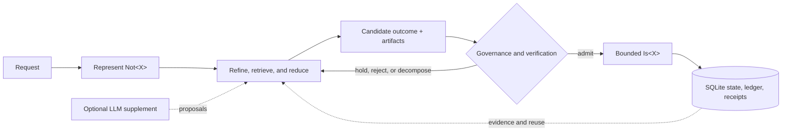

<div align="center">

# Realization

### Governed reduction. Durable artifacts. Inspectable consequences.

<p>
  
  
  
  
</p>

**A stateful research system for reducing represented non-achievedness toward
justified, governed outcomes.**

`Not<X> -> governed reduction -> Is<X>`

[Get things done](#get-things-done) |
[How it works](#how-it-works) |
[Current surface](#what-exists-today) |
[Architecture](#architecture) |
[Theory](#theory-reading-path)

</div>

---

> [!NOTE]
> **This repository implements and tests the model it documents.**
>
> That is a deliberately bounded statement. The repository now contains a
> runnable provider-free core, durable SQLite state, inspectable ledgers and
> artifacts, separately buildable core packages, governed ability machinery,
> a working subject-to-publication workflow, and machine-enforced architecture
> boundaries. It is not a claim of AGI, production readiness, empirical proof
> of the theory, or deterministic behavior from external models.

## Get Things Done

Choose the smallest surface that matches the work:

| Goal | Start here |
| --- | --- |
| Answer or calculate from deterministic mechanisms, without a model provider | [Run the standalone core](#run-one-local-task) |
| Ground a run in facts supplied by a person or another system | [Add evidence](#add-evidence) |
| Examine or continue a durable run | [Inspect or continue](#inspect-or-continue) |
| Learn, export, import, and reuse governed artifacts | [Reuse knowledge and abilities](#reuse-knowledge-and-abilities) |
| Turn source material into a reviewed report | [Workstation and publication](#workstation-and-publication) |
| Embed only the lifecycle engine in another application | [`core_runtime/`](core_runtime/) and [`core_engine/`](core_engine/) |

Start with `--llm off` unless model assistance is necessary. This gives the
clearest view of what Realization itself can determine from rules, supplied
evidence, and admitted artifacts. A run is successful only when its status and
certainty justify closure; the presence of fluent output alone is not success.

## The Idea

Most systems interpret a request as work to schedule. Realization first treats
it as a represented remainder:

```text
Not<X> = what remains insufficiently determined, evidenced, governed, or achieved
```

The controller asks whether that remainder should be closed directly, refined
into subordinate remainders, matched to prior artifacts, supported by evidence,
or held because certainty is not yet justified. Progress is not measured merely
by activity. It is measured by increased determination and an inspectable basis
for commitment.

This distinction drives the implementation:

- state survives the process that created it;
- proposals remain separate from admitted facts and actions;
- abilities remain separate from the host operations that realize them;
- model output remains advisory until governed;
- artifacts, receipts, and decisions remain inspectable after the run;
- deterministic operation remains available without an LLM.

## How It Works



The LLM is not the controller. It may propose a decomposition, interpretation,
or response; it does not silently admit an ability, grant authority, invent a
host implementation, or bypass persisted governance.

### Three bindings, three mechanisms

Ability delivery stays explicit by separating the matches that are often
collapsed in agent systems:

| Binding | Mechanism |
| --- | --- |
| Subject to ability | Explicit scope through linked skill identifiers and subject projection |
| Request to ability | Semantic retrieval and ranking; an LLM may assist interpretation when enabled |
| Ability to host operation | Exact, mechanical binding to a declared executor or broker identity |

A portable ability can be shipped without its host realizer. A host can provide
a realizer without making every ability that references it admitted. Execution
occurs only when declaration, admission, scope, realizer availability, policy,
and invocation authority all agree.

## What Exists Today

| Surface | Current reality |
| --- | --- |
| **Governed core CLI** | Fresh `run`, durable `resume`, read-only `inspect`, and an optional thin `chat` entry host over plain SQLite |
| **Core Python API** | Typed `run`, `resume`, and `inspect` functions behind a narrow package ABI |
| **Reduction loop** | Durable non-achievedness state, bounded steps, evidence, proposals, commitments, artifacts, and ledger entries |
| **LLM-off mode** | Provider-free execution through deterministic rules, parsers, retrieval, persisted artifacts, and available evidence |
| **Ability system** | Declaration, governance, admission, scope, semantic matching, realizer binding, authority, execution, and receipts in the full workspace |
| **Workstation** | Textual and Flutter clients over shared shell and subject-workflow contracts; visual parity is not claimed |
| **Subject workflow** | Gather, Itemize, Draft, Review, and Publication, with Chat used where conversational shaping is appropriate |
| **Publication** | Governed report planning and reproducible Markdown/Typst-oriented build artifacts |
| **Architecture controls** | A checked boundary manifest, import-graph baseline, qualification manifest, and regression ratchet |
| **Theory corpus** | Explicit theory documents kept distinct from implemented and verified behavior |

### Claim discipline

The project uses these terms narrowly:

| Term | Meaning |
| --- | --- |
| **Implemented** | The behavior exists in source and has a callable path |
| **Deterministically tested** | A provider-free automated gate exercises the behavior |
| **Qualified separately** | The behavior needs credentials, a model provider, browser, desktop service, or platform-specific host |
| **Theory** | A proposed explanatory or governing model; not automatically an implementation claim |

Provider-backed and browser-driven results are never used as substitutes for
deterministic tests. Conversely, provider-free tests do not establish the
quality or repeatability of an external model.

## Quick Start

### Prerequisites

- Python 3.14
- [uv](https://docs.astral.sh/uv/)
- Git

Clone the repository:

```console
git clone https://github.com/Adimpression/realization.git
cd realization
```

### Run one local task

Create a local state directory and run a bounded provider-free request:

```console
mkdir -p state

uv run --frozen --package realized-core realized-core run \
  --prompt "What is 2 + 2?" \
  --sqlite ./state/realization.sqlite3 \
  --state-out ./state/run.json \
  --max-steps 24 \
  --llm off
```

This exact example returns `4` without contacting a model provider. The command
prints a JSON summary, persists reusable artifacts in SQLite, and writes the
durable run state to `state/run.json`.

### Read the outcome

Do not evaluate a run from `final_answer` alone. Check these fields together:

| Field | What it tells you |
| --- | --- |
| `run_outcome` | Whether the bounded run completed, paused, or remained incomplete |
| `root.status` | Whether the root `Not<X>` is closed, paused, or still open |
| `root.certainty` | The certainty attached to the current root state |
| `final_answer` | The current communicative answer, if one was justified |
| `development.artifact_persistence` | Whether reusable artifacts were persisted and where |
| `recent_ledger` | Why the latest transitions, admissions, and commitments occurred |

An incomplete run may still emit a useful candidate answer. That candidate is
not equivalent to a closed, high-certainty result.

### Add evidence

Evidence is explicit input rather than hidden prompt context. Create
`state/evidence.json`:

```json
[
  {
    "target": "root",
    "observation": "The approved budget ceiling is SGD 25,000.",
    "source": "project charter",
    "support_strength": "high",
    "confidence": "high"
  }
]
```

Supply it to a fresh run:

```console
uv run --frozen --package realized-core realized-core run \
  --prompt "What is the approved budget ceiling?" \
  --evidence-file ./state/evidence.json \
  --sqlite ./state/realization.sqlite3 \
  --state-out ./state/budget-run.json \
  --max-steps 24 \
  --llm off
```

Evidence participates in governance; it does not force closure. Realization may
remain incomplete when the supplied observation does not determine the request
strongly enough.

### Inspect or continue

Inspect a saved state without executing another reduction step:

```console
uv run --frozen --package realized-core realized-core inspect \
  --state ./state/run.json
```

Resume from the durable state, optionally adding new evidence. Reuse the same
SQLite store so prior artifacts remain available:

```console
uv run --frozen --package realized-core realized-core resume \
  --state-in ./state/run.json \
  --sqlite ./state/realization.sqlite3 \
  --state-out ./state/resumed.json \
  --llm off
```

Writing resumed state to a new path preserves the prior checkpoint for audit
or comparison.

### Use the core as a governed chat participant

The standalone application also includes a thin terminal conversation host:

```console
uv run --frozen --package realized-core realized-core chat \
  --root ./state/chat \
  --llm off
```

Plain input creates an independent governed run. Use `/continue <text>` only
to supply a selected human contribution to the latest paused or incomplete
run. Use `/follow-up <text>` or `/correct <text>` to create a new run linked to
the latest completed result. The host keeps transcript, run bindings, state
JSON, and SQLite as separate durable domains; prior chat text is never admitted
as evidence merely because it appeared in the conversation.

### Choose an LLM policy

| Mode | Behavior |
| --- | --- |
| `--llm off` | Makes no provider call; closure is limited to deterministic mechanisms and supplied evidence |
| `--llm auto` | Permits configured model assistance while retaining mechanical governance boundaries |
| `--llm required` | Requires the configured model path rather than silently proceeding without it |

Start with `off`. Enable a provider only when the request, data policy, and
qualification context permit sending material outside the local process.
Credential-free templates are provided in
[`local.env.example`](local.env.example) and
[`offline.env.example`](offline.env.example).

List every standalone option directly from the installed command:

```console
uv run --frozen --package realized-core realized-core run --help
```

## The Standalone Core

The distributable core is intentionally split into three cohesive UV projects:

```text
realized-core
    -> realized-core-engine
        -> realized-core-runtime
```

| Project | Responsibility |
| --- | --- |
| [`core_runtime/`](core_runtime/) | Dependency-inverted run/resume lifecycle and protocols; no third-party dependencies |
| [`core_engine/`](core_engine/) | Canonical domain engine, state model, host mediation, and SQLite adapter |
| [`core_app/`](core_app/) | Thin `realized-core` command-line and conversation-host composition |

<details>
<summary><strong>What the standalone core deliberately does not include</strong></summary>

The `realized-core` distribution does not contain the workstation, Flutter or
Textual UI code, gRPC services, or publication workflow. Its public ABI does not
currently expose governed skill installation, subject activation, or
caller-supplied host-realizer registration. It executes only the packaged core
surface behind `run`, `resume`, and `inspect`; its optional `chat` command is an
entry-layer host over that same engine ABI, not another reasoning engine.

The projects are independently buildable. An eventual `uvx` installation path
depends on publishing all three distributions to an index; this README does not
claim that they are already published.

</details>

Build and verify source distributions and wheels locally:

```console
uv build core_runtime --out-dir dist/core-runtime
uv build core_engine --out-dir dist/core-engine
uv build core_app --out-dir dist/core-app
```

See [`core_app/README.md`](core_app/README.md) for the distribution contract
and [`scripts/verify_core_distribution.py`](scripts/verify_core_distribution.py)
for the isolation checks.

## Reuse Knowledge And Abilities

The repository workspace exposes artifact and ability operations that are not
part of the narrow `realized-core` distribution. Use these commands from a
checkout when developing, qualifying, or curating reusable material.

Learn governed artifacts from a Markdown document into SQLite:

```console
uv run --frozen python3 main.py markdown-learn \
  --markdown-file ./notes.md \
  --sqlite ./state/realization.sqlite3 \
  --state-out ./state/learning-run.json \
  --report-out ./state/learning-report.json \
  --llm off
```

Export admitted artifacts as reviewable YAML:

```console
uv run --frozen python3 main.py artifact-export \
  --all \
  --out-dir ./state/exported-artifacts \
  --sqlite ./state/realization.sqlite3
```

Import a reviewed artifact directory and run against the resulting store:

```console
uv run --frozen python3 main.py load-yaml-and-run \
  --artifact-dir ./state/exported-artifacts \
  --prompt "Apply the imported knowledge to this request." \
  --sqlite ./state/imported.sqlite3 \
  --state-out ./state/imported-run.json \
  --llm off
```

Import does not imply unconditional selection. Admissibility, current scope,
request matching, host-realizer availability, and authority remain separate
checks. Use `artifact-import`, `import-skill`, `export-skill`, and
`export-skill-registry` when the distinction between general artifacts and
portable abilities matters.

## Workstation And Publication

The full workspace adds a host-owned interaction surface around the governed
core:

```text
Chat
  |
  +--> Gather --> Itemize --> Draft --> Review --> Publication
  |
  +--> Permissions / Activity / Skills
```

- **Gather** stages and admits source material explicitly.
- **Itemize** turns admitted material into typed candidates.
- **Draft** shapes report scope and composition.
- **Review** owns approval and decision-oriented review.
- **Publication** locks inputs, builds outputs, and records release evidence.

Create a workstation session rooted in local state and attach the current
checkout as its workspace:

```console
uv run --frozen python3 controller_entrypoints.py workstation-launch \
  --root ./state/workstation \
  --workspace "$PWD" \
  --task "Build a reviewed report from the supplied source material."
```

Open the terminal workstation for that session:

```console
uv run --frozen python3 controller_entrypoints.py workstation-chat \
  --root ./state/workstation
```

Interactive natural-language chat requires the configured provider named by
the workstation session. The governed subject workflow and its deterministic
tests remain distinct from provider qualification. For the visual
source-to-publication flow, start the gRPC host and Flutter client as documented
in the Flutter guide below.

Textual and Flutter consume shared application and transport contracts, but
they are allowed to use different layout systems. Their behavioral boundaries
matter; pixel or sizing parity does not.

Start with:

- [Workstation model](workstation/WORKSTATION.md)
- [Learning Context](workstation/LEARNING_CONTEXT.md)
- [Publication](workstation/PUBLICATION.md)
- [Flutter client](workstation/ui_flutter/README.md)

## Architecture

Realization is organized around six responsibilities:

```text
Entry / Exchange
    |-- Workstation --------> LLM
    |        |--------------> Governance
    |        '--> shared host interaction
    |
    '-- Controller ---------> LLM
             |--------------> Governance
             '--> shared host interaction
                           |
                           v
                Runtime + Skill Execution
```

The controller and workstation converge on lower contracts rather than importing
each other's internals. UV workspace membership alone is not treated as a
boundary: each project needs a narrow package API, declared dependencies, and
import-ratchet enforcement.

The live enforcement surface is deliberately small:

- [Architecture rules](6-LAYER_ARCHITECTURE.md)
- [Component ownership](MODULES.md)
- [Boundary controls](architecture/README.md)
- [Boundary manifest](architecture/boundaries.toml)

Run the architecture ratchet:

```console
python3 scripts/check_architecture_boundaries.py
```

## Verification

The committed Google Cloud Build pipeline keeps deterministic checks separate
from provider-backed and browser qualifications. Its declared gates cover:

- package boundaries, dependency cycles, and import hygiene;
- core wheel construction and distribution isolation;
- core runtime, engine, and CLI equivalence;
- provider-free publication and incremental-report BDD paths;
- workstation activity, session isolation, and chat-context regressions.

Run the release-hygiene and architecture checks locally:

```console
python3 scripts/check_open_source_readiness.py
python3 scripts/check_architecture_boundaries.py
```

Build and verify the exact source-release contents outside the checkout:

```console
python3 scripts/build_release_export.py --output /tmp/realization-release
python3 scripts/check_release_provenance.py /tmp/realization-release
python3 scripts/check_open_source_readiness.py /tmp/realization-release
```

The release classification deliberately excludes captured reports, generated
runtime corpora, local state, and unresolved binaries while retaining the
reviewed fixtures needed by deterministic tests. See
[`RELEASE_CONTENT.md`](RELEASE_CONTENT.md) and
[`THIRD_PARTY_NOTICES.md`](THIRD_PARTY_NOTICES.md) before redistributing a
source snapshot or derived binary.

See [`cloudbuild.yaml`](cloudbuild.yaml) for the exact deterministic CI
commands and [`architecture/qualification-gates.toml`](architecture/qualification-gates.toml)
for gates that require separate qualification.

## Theory Reading Path

The theory is extensive, but the shortest useful route is:

| Read | Purpose |
| --- | --- |
| [`THEORY.md`](THEORY.md) | Canonical account of non-achievedness, governed reduction, reflection, contemplation, and certainty |
| [`ARTIFACT_MEDIATED_VERIFICATION.md`](ARTIFACT_MEDIATED_VERIFICATION.md) | Why opaque generators must emit independently checkable artifacts |
| [`AMV_NEURAL_NETWORK.md`](AMV_NEURAL_NETWORK.md) | How consequential checking relates to path hardening, weakening, and forgetting |
| [`INTELLIGENCE.md`](INTELLIGENCE.md) | Synthesis of memory, attention, production, meta-attention, verification, and consolidation |
| [`RESUMPTION.md`](RESUMPTION.md) | Governed continuity of state and non-achievedness across reductions |
| [`SKILL_INTERFACE.md`](SKILL_INTERFACE.md) | Ability declarations, governance, admission, host ABI, and interface invariants |
| [`PERMISSIONS.md`](PERMISSIONS.md) | Authority, grants, dispatch, and host-operation boundaries |

Theory documents make claims about the model. Implementation documents explain
what the code currently does. Tests establish only the behavior they actually
exercise.

## Repository Map

| Path | Contents |
| --- | --- |
| `core_runtime/` | Dependency-inverted lifecycle |
| `core_engine/` | Governed engine and SQLite implementation |
| `core_app/` | Narrow core CLI |
| `workstation/` | Contracts, services, adapters, Textual UI, Flutter UI, and publication workflow |
| `architecture/` | Current boundary controls and qualification baselines only |
| `tests/` | Core, architecture, governance, replay, and compatibility tests |
| `workstation/tests/bdd/` | User-journey BDD coverage |
| `trials/` | Explicit experimental and qualification material |
| `reports/` | Captured outputs; not source merely because they are checked in |
| `release/` | Machine-readable content classification and pinned release tooling |

## Status

> [!WARNING]
> Realization is pre-alpha research software. Persisted formats and public ABIs are
> treated carefully and covered by compatibility tests, but future changes may
> still require explicit migrations. Review host capabilities, imported
> abilities, authority grants, external-provider use, and generated publication
> material before relying on them in a sensitive environment.

The project is suitable for inspection, experimentation, deterministic core
runs, and careful contribution. Broader deployment claims require evidence that
is not made here.

## Contributing And Security

Read [`CONTRIBUTING.md`](CONTRIBUTING.md) before changing behavior or package
boundaries. Report vulnerabilities privately according to
[`SECURITY.md`](SECURITY.md). Community conduct is governed by
[`CODE_OF_CONDUCT.md`](CODE_OF_CONDUCT.md).

Licensed under the [Apache License 2.0](LICENSE).
